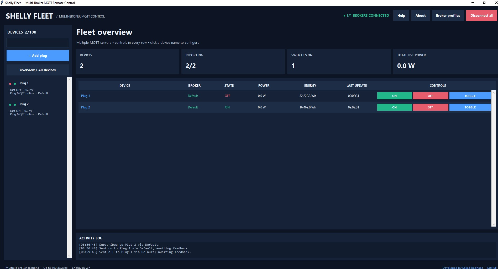
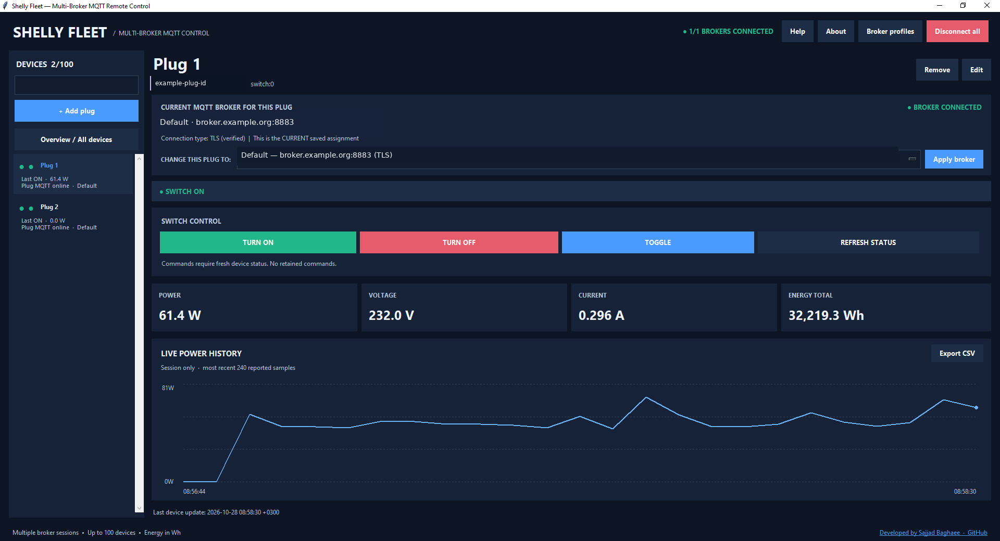
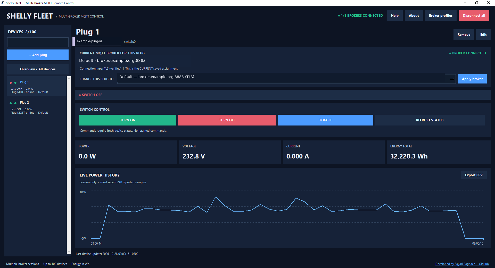
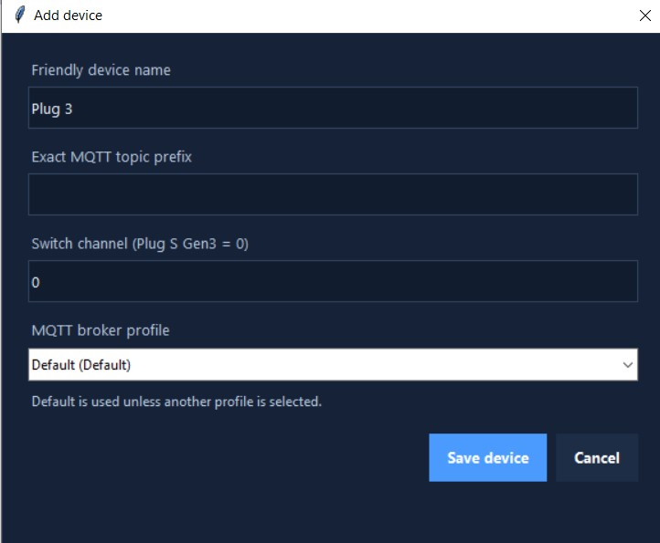
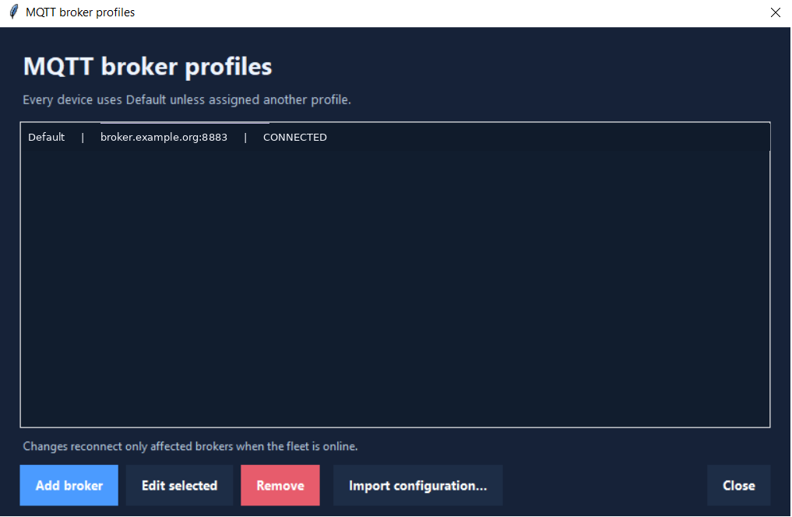
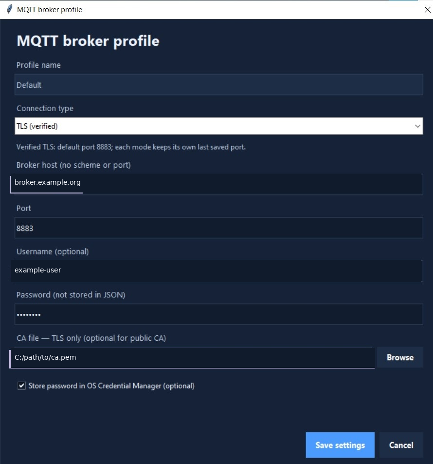

# Shelly Fleet

**Version 1.0.0 · Python / Tkinter · Open-source desktop application**

Developed by [Sajjad Baghaee](https://github.com/sajjadbaghaee/). Independent community project; not affiliated with or endorsed by Shelly.

Shelly Fleet is a desktop application for remotely controlling and monitoring up to **100 MQTT-enabled Shelly plugs**. It provides individual device pages, a fleet overview, multiple named MQTT broker connections, live electrical readings, short power-history charts, and CSV export.

## Features

- Manage up to 100 plugs from a searchable device sidebar and an overview dashboard.
- Turn devices **ON**, **OFF**, or **TOGGLE**; refresh their reported status.
- Display live power (W), voltage (V), current (A), and accumulated energy (Wh) separately for each device.
- View a power chart and export the current session's measurements to CSV.
- Distinguish last reported relay state from MQTT device presence. Consult **Help → Devices & Data** for the status legend and stale-data precautions.
- Assign each device to the **Default** broker or a named alternative; use multiple brokers at the same time.
- Support verified TLS and optional plain MQTT, with individual ports for each connection type and broker.
- Store configuration locally and optionally save broker passwords in the operating system credential manager.
- Consult the built-in Help guide, maintained in `resources/help_content.json`.

## Screenshots

The screenshots below demonstrate the main application workflows. Broker addresses and device identifiers have been replaced with generic examples before publication. Electrical readings are sample snapshots, not live data.

### Fleet overview

The main dashboard shows individual switch states, live power readings, accumulated energy, broker assignments, and ON/OFF/TOGGLE controls.

[](docs/images/fleet-overview.png)

### Individual device control and power monitoring

Each device has its own page with relay controls, current electrical measurements, and a session-based power history chart.

<table>
  <tr>
    <th>Device ON</th>
    <th>Device OFF</th>
  </tr>
  <tr>
    <td><a href="docs/images/device-on.png"></a></td>
    <td><a href="docs/images/device-off.png"></a></td>
  </tr>
</table>

### Device and MQTT broker configuration

Add devices with their MQTT topic prefix and switch channel, then assign the Default or another named broker profile. Broker settings support TLS (with optional custom CA trust) and plain MQTT for trusted private networks.

<table>
  <tr>
    <th>Add a device</th>
    <th>Broker profiles</th>
    <th>Broker configuration</th>
  </tr>
  <tr>
    <td><a href="docs/images/add-device.png"></a></td>
    <td><a href="docs/images/broker-profiles.png"></a></td>
    <td><a href="docs/images/broker-settings.png"></a></td>
  </tr>
</table>

## Requirements

- Python 3.10 or later.
- Tkinter (usually included with Python on Windows).
- Network access to MQTT brokers and the corresponding Shelly devices.
- Libraries listed in `requirements.txt`.

## Installation on Windows

1. Install Python from [python.org](https://www.python.org/downloads/) and select **Add Python to PATH**.
2. Extract the project ZIP to a folder of your choice.
3. Double-click `install_dependencies.bat`.
4. Double-click `start_shelly_fleet.bat`.

Or use the command line from the project folder:

```bat
python -m pip install -r requirements.txt
python shelly_fleet_gui.py
```

**First launch:** The app starts with one unconfigured **Default** broker profile and **zero registered plugs**. It includes no configured MQTT hostnames, usernames, passwords, certificates, or device identifiers.

## Connect a broker and add devices

1. Select **Broker profiles**, edit **Default**, and enter the MQTT server address, connection type, port, and any credentials. For TLS with a private certificate authority, select a trusted CA file.
2. Configure MQTT separately in your physical Shelly device's web interface; enable MQTT Control and status notifications. The plug and the app must connect to the same broker.
3. Select **+ Add plug** and enter a friendly name, its exact MQTT topic prefix, switch channel (typically `0` on Plug S Gen3), and the broker profile.
4. Select **Connect all**. Wait for a fresh device status before operating the controls.

You can create another named broker in **Broker profiles → Add broker**, then assign an individual plug to that broker from its device page. Each broker profile has independent host, transport, ports, credentials, and connection status.

## Generic MQTT topic patterns

The plug's actual prefix is user-supplied. MQTT Control topics generally follow this pattern:

```text
<device-prefix>/command/switch:0     on / off / toggle / status_update
<device-prefix>/status/switch:0      switch readings
<device-prefix>/error/switch:0       command errors
<device-prefix>/online               online / Last Will presence
```

Check your actual Shelly firmware and enabled MQTT functionality for compatibility. A successful publish does **not** guarantee that the physical relay switched; verify feedback before relying on the result.

## Status indicators

The two colored dots next to a device represent different things:

| Indicator | Green | Red | Gray |
| --- | --- | --- | --- |
| Relay | Last reported ON | Last reported OFF | Unknown |
| Plug MQTT | Online indication | Offline indication | Unknown |

**The relay indicator is the last reported value**, which can become stale during disconnections. The device's MQTT presence is independent of the desktop application's connection to its broker. Consult the built-in **Help → Devices & Data** for further explanations and safety precautions.

## Local storage and privacy

The distributed repository and ZIP have **no configured broker or plug information**. Settings you enter are written on your own computer:

```text
%APPDATA%\ShellyFleetDesktop\fleet_config.json
```

That local JSON may contain broker names, hosts, usernames, certificate paths, device names, and MQTT topic prefixes. **Passwords are not saved in JSON**; they may be saved using the OS credential manager if you opt in. Never upload personal configuration, screenshots of real broker settings, credentials, private keys, or certificate files to a public repository.

To bring a separately saved configuration into this installation, use **Broker profiles → Import configuration…** and explicitly confirm. The import replaces local broker/device profiles; for security, enter passwords manually afterward.

For a clean demonstration, launch with a temporary value of the `SHELLY_FLEET_DATA_DIR` environment variable. The normal launcher uses the persistent local user configuration.

## Security and limitations

- Prefer **TLS with certificate/hostname validation** on internet-accessible brokers.
- Plain MQTT is **unencrypted**; use it only on a trusted local network or through an appropriate private VPN.
- Apply least-privilege broker ACLs. Commands are sent without the MQTT retain flag.
- Never assume an offline plug is OFF or safely de-energized.
- Power plots and CSV exports include **session-only** samples (not persistent historical or billing-grade measurements).
- Test device firmware, broker access, and command behavior before controlling real equipment.

See [SECURITY.md](SECURITY.md) for safe configuration and publication guidance.

## Documentation and contributions

The built-in Help pages are stored in [`resources/help_content.json`](resources/help_content.json), separate from `shelly_fleet_gui.py`. Keep this folder next to the main script.

For the initial release summary, see [RELEASE_NOTES.md](RELEASE_NOTES.md).

Shelly MQTT API documentation: https://shelly-api-docs.shelly.cloud/gen2/ComponentsAndServices/Mqtt/

Licensed under the [MIT License](LICENSE).
